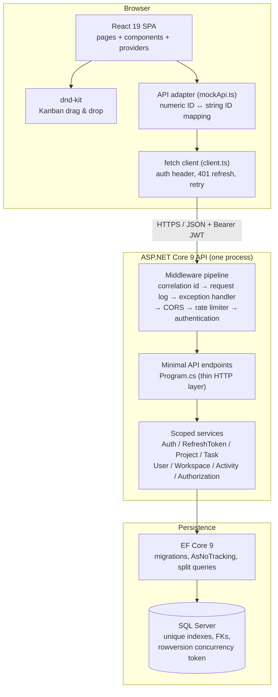
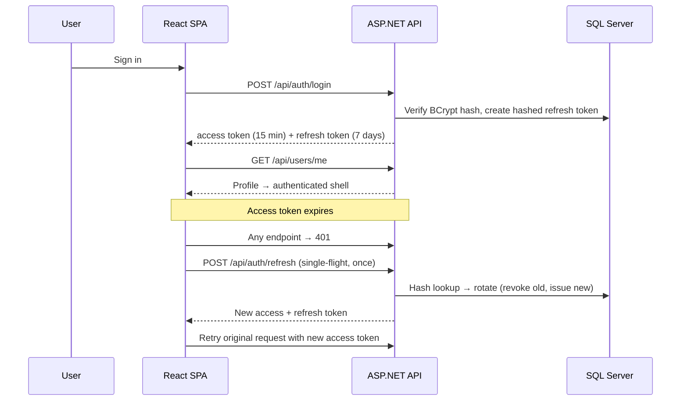

# TaskFlow

TaskFlow is a full-stack project management application: a React 19 + TypeScript single-page frontend backed by an ASP.NET Core 9 Web API, EF Core and SQL Server. It provides Kanban-style boards, projects, teams, JWT authentication, subtasks, comments, and an activity feed.

I'm **Dhergham Fadhil Awad**, the author and maintainer of TaskFlow. I designed the system, made the architecture and stack decisions, built the application, and wrote this README to explain the reasoning behind those choices in my own words.

> **Proprietary software.** See [License](#license).

---

## Contents

- [What TaskFlow does](#what-taskflow-does)
- [System design](#system-design)
  - [Component view](#component-view)
  - [Request lifecycle](#request-lifecycle)
  - [Domain model](#domain-model)
  - [Core mechanisms and why I designed them this way](#core-mechanisms-and-why-i-designed-them-this-way)
- [Architecture: decisions and alternatives](#architecture-decisions-and-alternatives)
- [Technology stack and why I chose it](#technology-stack-and-why-i-chose-it)
- [Challenges I faced and how I overcame them](#challenges-i-faced-and-how-i-overcame-them)
- [Known limitations](#known-limitations)
- [Future improvements](#future-improvements)
- [Getting started](#getting-started)
- [API endpoints](#api-endpoints)
- [Testing and verification](#testing-and-verification)
- [Project structure](#project-structure)
- [Author](#author)
- [License](#license)

---

## What TaskFlow does

- **Authentication:** register/login with JWT access tokens, BCrypt password hashing, refresh-token rotation, revocation, and role-based access control (`admin`, `member`, `viewer`).
- **Projects:** create, update, delete; add/remove members; set status (`active` / `paused` / `completed`).
- **Tasks:** create, update, delete; drag-and-drop Kanban board; status (`backlog` / `in_progress` / `review` / `done`), priority (`low` / `medium` / `high` / `urgent`), assignees, due dates, labels, and gap-based ordering.
- **Subtasks:** per-task checklists with completion toggling.
- **Comments:** attributed discussion on each task.
- **Activity feed:** audit trail of create / update / delete / move / comment actions across projects the caller can see.
- **Operability:** per-client-IP rate limiting, correlation IDs on every response, structured request logs, consistent JSON errors, paginated list endpoints, and CI.

Screenshots are in [`screenshots/`](screenshots/) (dashboard, projects, board, activity feed, mobile login).

---

## System design

### Component view

I designed TaskFlow as a **modular layered monolith** with a decoupled SPA. The API is a single deployable unit; the separation lives in code (endpoints → services → data), not in network boundaries.



**Layers and responsibilities**

| Layer | Code | Responsibility | Deliberately does *not* do |
| --- | --- | --- | --- |
| Presentation | `src/pages`, `src/components`, `src/context` | Render UI, own client state, translate domain types | Authorize users or talk to SQL |
| Edge / transport | `src/api/client.ts`, `src/api/mockApi.ts` | Auth headers, token refresh, error mapping, DTO ↔ UI mapping | Business rules |
| HTTP endpoints | `src/TaskFlow.Api/Program.cs` | Routing, DTO validation, auth attributes, status codes | Business logic or raw data access |
| Application services | `src/TaskFlow.Api/Services/` | Business rules, authorization, transactions, activity logging | HTTP concerns |
| Data access | `src/TaskFlow.Api/Data/`, `Models/`, `Migrations/` | EF mapping, constraints, migrations, query shaping | Business rules |

### Request lifecycle

1. A request arrives with an optional `X-Correlation-Id`. A middleware echoes it on every response (or generates one) so a client report can be traced to a log line.
2. Structured logging records method, path, status, duration and authenticated user id.
3. A global exception handler converts exceptions into `{ error, correlationId }` JSON with safe status codes (400 / 403 / 404 / 409 / 500) — no stack traces leak to clients.
4. CORS (configuration-driven origins), then rate limiting (IP-partitioned fixed windows), then JWT authentication and authorization.
5. A minimal endpoint validates the DTO explicitly (Minimal APIs do not auto-validate DataAnnotations), extracts the user id from the JWT, and calls a scoped service passing a `CancellationToken`.
6. The service checks resource-level authorization, applies business rules, and performs one or more EF Core operations; writes that must be atomic share a transaction or a single `SaveChangesAsync`.
7. The response is mapped to a DTO, serialized as camelCase JSON, and the frontend adapter converts numeric IDs back to the UI's string IDs.

Authentication flow (including transparent refresh):



### Domain model

| Entity | Key fields | Notable constraints / behavior |
| --- | --- | --- |
| `User` | Id, Email, PasswordHash, Name, Role, CreatedAt | Unique index on normalized (lowercase) email; role is an enum stored as string |
| `Project` | Id, Name, Description, Color, Icon, Status, DueDate, OwnerId | Owner FK `Restrict`; cascade to members and tasks |
| `ProjectMember` | Id, ProjectId, UserId, JoinedAt | Unique `(ProjectId, UserId)`; cascade from both sides |
| `ProjectTask` | Id, Title, Status, Priority, AssigneeId, Labels (JSON), DueDate, Order, RowVersion | Unique `(ProjectId, Status, Order)`; `decimal(18,4)` gap ordering; `[Timestamp]` rowversion |
| `SubTask` | Id, TaskId, Title, Done | Cascade from task |
| `Comment` | Id, TaskId, AuthorId, Body, CreatedAt | Cascade from task, `Restrict` from author to preserve attribution |
| `Activity` | Id, ActorId, Action, Target, Kind, ProjectId, TaskId | Cascade from project, `SetNull` from task |
| `RefreshToken` | Id, UserId, TokenHash, CreatedAt, ExpiresAt, RevokedAt, ReplacedByToken | Only SHA-256 hashes are stored; single-use rotation chain |

Foreign keys with explicit delete behaviors (`Cascade` / `Restrict` / `SetNull`) keep deletes safe and audit data meaningful. Enums are persisted as strings via `HasConversion<string>()`, so the database is readable and the wire format stays stable.

### Core mechanisms and why I designed them this way

**1. Authorization is resource-scoped, not just role-scoped.** `[Authorize]` proves *who the caller is*; `IAuthorizationService` decides *what the caller may touch*. Access is granted to project owners, project members, and admins; management is limited to owners/admins; `viewer` is read-only via `CanWriteAsync`, checked at the start of every mutating service method. Task access is derived from its project. This keeps the rule in one place and makes it unit-testable instead of duplicating checks across endpoints.

**2. Kanban ordering uses fractional gaps plus optimistic concurrency.** Each column position is a `decimal(18,4)` value; moving an item computes a value between its neighbours (or halves the head value / appends +1000), so a move touches **one row** instead of renumbering the whole column. A unique index on `(ProjectId, Status, Order)` forbids duplicate positions; a SQL Server `rowversion` detects lost updates. Retries (bounded, with entity detaching and `ReloadAsync`) absorb concurrent creates and moves; when retries are exhausted the API returns `409 Conflict`. When gaps run out, the column is rebalanced.

**3. Refresh tokens are hashed, single-use, and rotatable.** The raw token goes to the client; the server stores only its SHA-256 hash. Rotation revokes the previous token and links it to its replacement (`ReplacedByToken`), so replay is detectable. Access tokens live 15 minutes and carry a `jti` claim; refresh tokens live 7 days. Both lifetimes are configurable. I never hardcode demo credentials; I supply them via environment variables or user secrets.

**4. Writes are atomic with the audit trail.** Creating a task saves the task first so its generated ID is valid, then logs the activity inside the same explicit transaction (a no-op under the in-memory test provider). Updates, deletes, comments and moves write the activity in a single `SaveChangesAsync`, so EF's implicit transaction guarantees both or neither.

**5. Lists are paginated and query-shaped.** `PaginationValidation` clamps/validates page and size, project lists fetch the page of IDs first before including task graphs, `AsNoTracking` avoids change-tracker overhead on reads, SQL Server uses split queries, and the workspace endpoint reports `TasksTruncated` instead of silently dropping data.

**6. Cross-cutting concerns are middleware, not endpoint code.** Rate limits are partitioned by client IP (1000/min global, 5/min on auth endpoints) so one client cannot exhaust a shared bucket or lock out others. Correlation IDs, structured logs, and `ExceptionMapping` give every failure a traceable, consistent shape. All service methods and endpoints thread a `CancellationToken` so client disconnects cancel work.

**7. Tooling is decoupled from runtime secrets.** An `IDesignTimeDbContextFactory<ApplicationDbContext>` lets `dotnet ef` build a context without valid JWT/demo configuration, and startup migrations are opt-in via `Database:AutoMigrate`. The generated idempotent SQL script is uploaded as a CI artifact for review before production rollout.

---

## Architecture: decisions and alternatives

This table records the choices I made and the alternatives I rejected. It is the "why not X" companion to the system design above.

| Decision | What I chose | Alternatives considered | Why I chose it |
| --- | --- | --- | --- |
| Overall shape | Modular layered monolith in one API process | Microservices; serverless functions | A single deployable unit keeps transactions (task + activity), authorization, and local development simple; layer boundaries still allow a future split. Microservices would add network failures and distributed transactions with no scaling need. |
| API style | ASP.NET Core Minimal APIs | MVC controllers; GraphQL; gRPC | Less ceremony, explicit endpoints, easy DTO validation and status codes; OpenAPI is available in development. GraphQL would add query complexity/caching concerns; gRPC is unnecessary for a browser client. |
| Frontend rendering | Client-side SPA (Vite + React) | Next.js SSR/RSC; Razor Pages/Blazor | A highly interactive board benefits from instant client-side drag-and-drop; a separate static frontend scales independently and avoids server rendering complexity. SEO is not a requirement. |
| Client state | Context providers + a thin API adapter; optimistic local updates then `refresh()` | Redux; Zustand; TanStack Query | The shared state is one workspace object with a handful of actions. Context plus adapter avoids boilerplate and keeps ID/type translation in one place. A query cache is a natural future upgrade (see [Future improvements](#future-improvements)). |
| Drag & drop | `@dnd-kit/core` + `sortable` | `react-beautiful-dnd`; native HTML5 DnD | dnd-kit is maintained, accessible (keyboard/screen-reader support), React 19-compatible, and sensor-driven; HTML5 DnD has poor mobile/accessibility behavior. |
| Styling & motion | Tailwind CSS + Framer Motion + Lucide icons | CSS Modules; styled-components; Bootstrap | Tailwind keeps styles co-located and consistent via a design token config; utility classes avoid naming overhead. Framer Motion and Lucide add polished motion/icons with minimal code. |
| Authentication | Stateless JWT + rotating refresh tokens | Server-side sessions; OAuth/identity provider; opaque tokens | No server session store and natural horizontal scaling; rotation limits replay windows. A full IdP is valuable later but overkill for this scope (see roadmap). Sessions would require sticky state or a shared store. |
| Authorization | Central `IAuthorizationService` + RBAC enum | Endpoint `[Authorize(Roles=…)]` only; per-handler ad-hoc checks | Resource ownership and membership cannot be expressed by role attributes alone; one service gives consistent 403 behavior and testability. |
| Data access | EF Core with migrations | Dapper/raw SQL; NoSQL (MongoDB) | EF gives typed queries, migrations, change tracking for concurrency tokens, and provider portability in tests. Relational constraints (uniqueness, FKs, rowversion) are essential to ordering/audit correctness; a document store would push them into application code. |
| Database | SQL Server | PostgreSQL; SQLite | Strong `rowversion` support and a natural fit with the .NET stack; SQLite cannot validate the concurrency/constraint behavior I rely on (Postgres remains a reasonable future port). |
| Ordering strategy | Gap-based decimal positions + unique index + rowversion | Integer reindexing of whole columns; lexicographic "fractional index" strings; insertion at end only | Integer reindexing rewrites many rows and races under concurrent drags; gap ordering touches one row and the unique index catches collisions deterministically. |
| Rate limiting | IP-partitioned fixed window, separate auth policy | One global bucket; sliding window/token bucket; API-key limits | Fixed windows are cheap and predictable; partitioning prevents noisy-neighbour starvation, and the tighter auth policy throttles credential stuffing. Sliding windows are a possible refinement. |
| Testing | xUnit + EF InMemory for logic; Vitest for the client | Full SQL/Testcontainers integration tests only; Jest | InMemory tests are fast and deterministic for service logic; Vitest is native to Vite and fast. The trade-off (no real FK/index/rowversion verification) is documented under [Known limitations](#known-limitations). |
| Error handling | Central exception → status mapping + correlation IDs | Try/catch in each endpoint; developer exception page | One source of truth for status codes and messages, no stack traces in production, and every error is traceable. |

---

## Technology stack and why I chose it

### Frontend

| Technology | Role | Why over alternatives |
| --- | --- | --- |
| React 19 | UI library | Largest ecosystem and component model suited to a board UI; mature compatibility with dnd-kit and testing tools. |
| TypeScript 5 | Type safety | Catch DTO/state mismatches at compile time; strict config in `tsconfig.app.json`. |
| Vite 5 | Dev server & bundler | Fast HMR and ESM-native builds; simpler config than Webpack; Vitest shares its pipeline. |
| React Router 6 | Routing | Nested routes with `RequireAuth` guard around the authenticated shell. |
| Tailwind CSS 3 | Styling | Design tokens in `tailwind.config.js`, rapid responsive UI, no CSS naming overhead. |
| @dnd-kit | Kanban drag & drop | Accessible, sensor-based, React 19-ready; supports sortable columns. |
| Framer Motion | Transitions | Declarative animations for panels/cards without hand-written CSS keyframes. |
| Lucide React | Icons | Tree-shakeable, consistent icon set. |
| date-fns | Date formatting | Small, modular date utilities for due dates. |
| clsx + tailwind-merge | Class composition | Conditional classes without duplicate Tailwind utilities. |
| Vitest + Testing Library + happy-dom | Frontend tests | Runs in the Vite pipeline with a DOM-like environment; fast unit tests for the API client. |

### Backend & data

| Technology | Role | Why over alternatives |
| --- | --- | --- |
| ASP.NET Core 9 (Minimal APIs) | HTTP host | High-performance, built-in DI/auth/rate limiting/OpenAPI; minimal boilerplate. |
| EF Core 9 + SQL Server provider | ORM & migrations | Typed LINQ, migrations, explicit delete behaviors, rowversion concurrency, split-query support. |
| EF Core InMemory provider | Unit-test provider | Fast service tests without a database (with the documented constraint trade-off). |
| JWT Bearer authentication | Stateless auth | Standard middleware, claim-based identity, easy `jti`/role claims. |
| BCrypt.Net-Next | Password hashing | Adaptive salted hashing; appropriate cost factor for password storage. |
| System.Security.Cryptography (SHA-256, RNG) | Refresh-token protection | Store hashes, not bearer tokens; CSPRNG-generated 32-byte tokens. |
| ASP.NET Core Rate Limiting | Throttling | Built-in partitioned fixed-window limiters and `429`/`Retry-After` handling. |
| xUnit | Backend tests | 121 tests across services, authorization, concurrency, pagination, refresh tokens, seeder and error contracts. |
| .NET CLI + dotnet-ef | Build/tooling | Reproducible builds, design-time factory for EF commands, idempotent migration script in CI. |

### DevOps

| Technology | Role | Why |
| --- | --- | --- |
| GitHub Actions | CI | Every push/PR builds .NET and the frontend, runs both test suites, and generates a migration script artifact. |
| GitHub credential manager / user secrets | Secrets | Keys and demo credentials stay out of source control; CI uses a throwaway test key with demo mode off. |

---

## Challenges I faced and how I overcame them

These are the real issues I encountered while building and auditing TaskFlow, not hypotheticals. The audit trail I kept lives in [`docs/`](docs/) (`baseline.md`, `remediation-report.md`).

| Challenge | Why it mattered | How I overcame it |
| --- | --- | --- |
| `dotnet ef` failed without JWT/demo secrets | Design-time tooling tried to resolve the full host and threw "JWT key is missing or too short", blocking migrations from the CLI. | Added `IDesignTimeDbContextFactory<ApplicationDbContext>` so EF builds a context without production-shaped configuration. `dotnet ef migrations list` now succeeds with no env vars; the obsolete failure is annotated in the baseline. |
| Concurrent drag-and-drop lost updates and collided on task order | Two moves could compute the same position, hit the unique index, or overwrite each other. | Fractional gaps with `decimal(18,4)`, unique `(ProjectId, Status, Order)` index, `[Timestamp]` rowversion, bounded retries with detach/`ReloadAsync`, column rebalancing when gaps run out, and `409 Conflict` on exhaustion. Concurrency tests cover retry behavior. |
| Activity rows referenced unsaved entities (`Id = 0`) | Logging an activity before saving the task produced invalid foreign keys. | Save the entity first, then log the activity in the same explicit transaction; for updates/deletes/comments/moves use a single `SaveChangesAsync` so both writes are atomic. |
| Refresh tokens were a replay/theft risk | Storing raw tokens would expose all active sessions if the DB leaked; long-lived tokens widened the window. | Store SHA-256 hashes only, 32-byte CSPRNG tokens, single-use rotation with `ReplacedByToken`, explicit revoke/revoke-all, short 15-minute access tokens with `jti`, configurable lifetimes, and no hardcoded demo credentials. |
| A single global rate-limit bucket could be exhausted by one client | One noisy or malicious client would lock out every other user; auth endpoints needed stricter protection. | Partitioned the limiter by `Connection.RemoteIpAddress` and added a separate 5/min auth policy (vs 1000/min global), with `429` + `Retry-After: 60`. Partition-key tests verify distinct buckets; `X-Forwarded-For` is intentionally not trusted yet. |
| Inconsistent error responses and leaked stack traces | Clients could not rely on error shapes; debugging was hard without a trace id. | `ExceptionMapping` maps domain/infrastructure exceptions to 400/403/404/409/500 with safe messages; correlation-id middleware echoes `X-Correlation-Id` and includes it in every structured log and error body. |
| Whole-graph reads and unbounded lists | Loading every project with all tasks/subtasks/comments for a list page did not scale. | Page IDs first, then include only that page's graph; `AsNoTracking`, SQL split queries, validated pagination, and a `TasksTruncated` flag instead of silent truncation in the workspace response. |
| Duplicate accounts under concurrent registration | A read-then-write uniqueness check races. | Normalize emails to lowercase and enforce a unique database index; catch `DbUpdateException` and return a generic error that also prevents email enumeration. |
| Stringly-typed roles/statuses and dead access-control code | Role checks like `== "admin"` and an obsolete `AccessControl.cs` made behavior hard to reason about. | Introduced `UserRole`/`TaskStatus`/`TaskPriority` enums with string conversion, centralized authorization in `IAuthorizationService`, removed dead files, and added viewer read-only checks on all mutating service paths. |
| A doubled `/api/api/auth/refresh` prefix in the client | The frontend base URL already ended in `/api`, risking broken refreshes. | Standardized the base URL contract (`VITE_API_URL` ends in `/api`) and made `client.ts` post to `${API_BASE_URL}/auth/refresh`; covered by 8 Vitest tests for JSON/204/empty/error/401/refresh behavior. |
| Migrations did not match the audit plan | The plan expected ~12 named migrations; the tree had 2 consolidated ones, which could mislead future readers. | Worked against the actual tree, kept two valid migrations plus an idempotent script, and documented the discrepancy explicitly in the remediation report instead of fabricating history. |
| PowerShell vs Bash environment setup | Bash-style `VAR=value cmd` prefixes in notes failed in the Windows shell. | Documented both user-secrets and PowerShell `$env:JWT__KEY=…` forms; CI uses YAML `env` values. |
| Test provider cannot prove database constraints | EF InMemory enforces no FKs, unique indexes, or rowversion; migration SQL was never applied to a real server. | Documented this limitation prominently, added an idempotent migration script artifact in CI, and listed SQL Server integration tests as a priority (see below). |
| Frontend bundle warning | Production build emits a ~650 kB JS chunk warning. | Accepted for now (build still succeeds); code splitting is scheduled in the roadmap. |

---

## Known limitations

Be aware of these when deploying or extending TaskFlow:

1. **No runtime SQL Server verification in CI.** Tests use EF InMemory, so foreign keys, unique indexes, CHECK constraints and rowversion concurrency are proven only by model configuration and generated SQL, not by a live database. CI has no SQL Server service container.
2. **No access-token revocation store.** Access tokens carry a `jti` claim and are short-lived, but there is no denylist; logout clears client tokens only. Refresh tokens can be revoked.
3. **Forwarded headers not trusted.** Rate-limit partitions use `Connection.RemoteIpAddress`; behind a proxy, all clients may share an IP unless forwarded-header middleware is configured.
4. **Demo reset is destructive by design.** `/api/workspace/reset` deletes all data and reseeds; it is gated on admin + demo mode + non-production, but should never be enabled in a real deployment.
5. **Bundle size.** The single frontend chunk triggers Vite's 500 kB warning; route-level code splitting is not implemented yet.
6. **Email is not verified and there is no password reset.** Registration trusts the supplied address.
7. **Two consolidated migrations** exist rather than a long history; treat the idempotent script as the source of truth for schema deployment.

---

## Future improvements

This is the roadmap I plan to follow, prioritized by what matters most. Each item builds directly on the design above.

**P0 — Correctness and confidence**
1. **SQL Server integration tests** with Testcontainers (or a CI service container): apply migrations to a real database and verify FKs, the unique email and order indexes, cascade behaviors, the duplicate-email path, and the concurrent-move `409`. This closes the biggest verification gap.
2. **Harden and lock in viewer RBAC.** The service layer now checks `CanWriteAsync`; add endpoint-level policy tests and verify every mutating path (including future ones) through a shared guard or convention so a new endpoint cannot accidentally skip it.
3. **Consolidate and verify the migration history.** Reconcile the two consolidated migrations with deployment expectations, add a repeatable "migrations are in sync with the model" CI check, and review the generated idempotent SQL as a release artifact.

**P1 — Security and scale**
4. **Token revocation / session management.** Use the `jti` claim with a short-lived denylist (or Redis) for logout-everywhere and suspicious-token revocation; expose session listing and revoke-all in the UI.
5. **Trust forwarded headers and smarter throttling.** Configure `ForwardedHeaders` with a known-proxy allowlist, then consider sliding-window or token-bucket limiters and per-account limits in addition to per-IP.
6. **Query-count regression guard.** Add an EF interceptor and a test-only assertion for list endpoints so a future change cannot silently reintroduce N+1 or whole-graph loads; finish projecting `ProjectService.ListAsync` into a single page query.
7. **Move ordering to a dedicated design.** Evaluate a `fractional index` library or a per-column sequence service with periodic rebalancing as a job, and add a regression test for exhausting decimal gaps.

**P2 — Product and UX**
8. **Real-time collaboration.** Push board changes with SignalR (or SSE) and broadcast move events, replacing the current "optimistic update + full workspace refresh" with targeted cache updates.
9. **TanStack Query or similar client cache** to replace repeated full `refresh()` calls, add background refetch, stale-while-revalidate, and finer-grained optimistic updates.
10. **Code split the frontend** with route-level `React.lazy`/dynamic imports and manual chunks to remove the 650 kB bundle warning.
11. **Richer task features:** due-date reminders, filtering/saved views, attachments, bulk actions, and undo for moves.
12. **Email verification and password reset**, plus optional OAuth/SSO via an identity provider.

**P3 — Operability**
13. **Deploy and observe:** containerize the API and SPA, add health/readiness/liveness endpoints beyond `/api/health`, and ship logs/metrics/traces to OpenTelemetry + Grafana or Application Insights using the existing correlation IDs.
14. **Progressive migration to PostgreSQL** (EF Core makes this feasible) if hosting cost or portability becomes a priority, with integration tests run against both providers.

---

## Getting started

### Prerequisites

- .NET 9 SDK
- Node.js 18+ and npm
- SQL Server (LocalDB, Docker, or hosted)

### Backend setup

1. Navigate to the API project:
   ```bash
   cd src/TaskFlow.Api
   ```

2. Configure JWT settings and demo credentials. The JWT key must be at least 32 characters. Demo credentials are required to create the demo administrator account; I never hardcode them. I supply them through environment variables or .NET User Secrets:
   ```bash
   dotnet user-secrets set "Jwt:Key" "your-32-character-minimum-secret-key-here"
   dotnet user-secrets set "Demo:Email" "dhergham@example.com"
   dotnet user-secrets set "Demo:Password" "password123!"
   ```
   Without `Demo:Email` and `Demo:Password`, no demo user is seeded and login will fail. In PowerShell, the equivalent environment-variable form is `$env:JWT__KEY='…'; $env:DEMO__EMAIL='…'; dotnet run`.

3. Run the API:
   ```bash
   dotnet run
   ```
   The API applies pending migrations automatically on startup (`Database:AutoMigrate`, default `true`) and listens on `http://localhost:5187` by default.

### Frontend setup

1. Copy the environment example:
   ```bash
   cp .env.example .env
   ```

2. Install dependencies and run the dev server:
   ```bash
   npm install
   npm run dev
   ```
   The frontend runs on `http://localhost:5173` and connects to the API at `VITE_API_URL` (`http://localhost:5187/api` by default).

3. Build for production:
   ```bash
   npm run build
   ```

### Configuration reference

Backend (`appsettings*.json`, user secrets, or environment variables — use `:` separators in config and `__` in environment variables):

| Variable | Purpose | Default |
| --- | --- | --- |
| `Jwt:Key` | Signing key (min 32 chars) | Dev fallback only; required outside Development |
| `Jwt:Issuer` / `Jwt:Audience` | Token issuer/audience | `TaskFlowApi` / `TaskFlowClient` |
| `Jwt:AccessTokenMinutes` | Access-token lifetime | `15` |
| `Jwt:RefreshTokenDays` | Refresh-token lifetime | `7` |
| `Demo:Enabled` | Enable demo seeding/reset | `false` |
| `Demo:Email` / `Demo:Password` / `Demo:Name` | Demo admin credentials (required when demo mode is on) | none |
| `Cors:Origins` | Allowed frontend origins | `localhost:5173` in Development |
| `Database:AutoMigrate` | Apply migrations on startup | `true` |
| `Testing:Enabled` | Use EF InMemory instead of SQL Server | `false` |

Frontend (`.env`):

| Variable | Purpose | Default |
| --- | --- | --- |
| `VITE_API_URL` | API base URL (no trailing slash suffix beyond `/api`) | `http://localhost:5187/api` |

### Rate limits

| Scope | Policy | Limit (per client IP) | Window |
| --- | --- | --- | --- |
| All endpoints | `global` | 1000 requests | 1 minute |
| `/api/auth/register`, `/login`, `/refresh`, `/revoke` | `auth` | 5 requests | 1 minute |

Exceeding a limit returns `429 Too Many Requests` with `Retry-After: 60`.

---

## API endpoints

### Authentication
- `POST /api/auth/register` — Register a new user
- `POST /api/auth/login` — Authenticate and receive access + refresh tokens
- `POST /api/auth/refresh` — Rotate the refresh token
- `POST /api/auth/revoke` — Revoke a refresh token (requires auth)

### Users
- `GET /api/users/me` — Get current user profile
- `PUT /api/users/me` — Update user profile

### Projects
- `GET /api/projects` — List accessible projects (paginated)
- `GET /api/projects/{id}` — Get a project
- `POST /api/projects` — Create a project
- `PUT /api/projects/{id}` — Update a project
- `PUT /api/projects/{id}/status` — Change project status
- `DELETE /api/projects/{id}` — Delete a project
- `POST /api/projects/{id}/members` — Add a member
- `DELETE /api/projects/{id}/members/{userId}` — Remove a member
- `GET /api/projects/{projectId}/tasks` — List a project's tasks (paginated)

### Tasks
- `GET /api/tasks` — List tasks (filter by project/status, paginated)
- `POST /api/tasks` — Create a task
- `GET /api/tasks/{id}` — Get a task
- `PUT /api/tasks/{id}` — Update a task (partial)
- `DELETE /api/tasks/{id}` — Delete a task
- `POST /api/tasks/{id}/move` — Move a task to a status/index
- `POST /api/tasks/{taskId}/subtasks/{subtaskId}/toggle` — Toggle subtask completion
- `POST /api/tasks/{taskId}/comments` — Add a comment

### Workspace & activity
- `GET /api/workspace` — Workspace summary with truncation signal
- `GET /api/activities` — Paginated activity feed
- `POST /api/workspace/reset` — Reset to demo state (admin only, demo mode, non-production)
- `GET /api/health` — Health probe

Errors use `{ "error": string, "correlationId": string }`; every response includes `X-Correlation-Id`.

---

## Testing and verification

| Suite | Command | Latest result |
| --- | --- | --- |
| Backend (xUnit) | `dotnet test src/TaskFlow.Api.Tests/` | **121 passed**, 0 failed |
| Frontend (Vitest) | `npm test` | **8 passed**, 1 file |
| Build | `dotnet build TaskFlow.sln` and `npm run build` | Both succeed (0 warnings in .NET; Vite emits a chunk-size advisory) |
| EF tooling | `dotnet ef migrations list --project src/TaskFlow.Api` | 2 migrations listed, no env vars required |
| CI | `.github/workflows/ci.yml` | Build + both test suites + idempotent migration script artifact on every push/PR |

Backend coverage includes auth, refresh rotation/revocation, project and task services, project membership, viewer role enforcement, concurrency/ordering, pagination, workspace, database seeding safety, rate-limit partitioning, and exception/error-contract mapping. See [`docs/remediation-report.md`](docs/remediation-report.md) for the full verification record and honest caveats.

---

## Project structure

```text
Task Flow/
├── src/
│   ├── TaskFlow.Api/             # ASP.NET Core 9 Web API
│   │   ├── Services/             # Business logic (Auth, RefreshToken, Project, Task, User,
│   │   │                         #   Workspace, Activity, Authorization, ExceptionMapping, …)
│   │   ├── Data/                 # DbContext + design-time factory
│   │   ├── Dtos/                 # Data transfer objects
│   │   ├── Models/               # Entities and enums (User, Project, ProjectTask, SubTask,
│   │   │                         #   Comment, Activity, RefreshToken, …)
│   │   ├── Migrations/           # EF Core migrations + model snapshot
│   │   ├── Program.cs            # Endpoints, middleware, auth, rate limiting, DI
│   │   └── appsettings*.json     # Configuration
│   ├── TaskFlow.Api.Tests/       # xUnit backend tests
│   ├── api/                      # Frontend API layer
│   │   ├── client.ts             # Fetch wrapper, auth headers, 401 refresh, retry
│   │   ├── mockApi.ts            # DTO ↔ UI type adapter (delegates to client.ts)
│   │   └── client.test.ts        # Vitest tests
│   ├── components/               # React components (auth, board, dashboard, layout, …)
│   ├── context/                  # Providers (Auth, Workspace, Theme, Toast, UI)
│   ├── data/                     # Frontend data helpers
│   ├── lib/                      # Utilities
│   ├── pages/                    # Route pages
│   ├── types/                    # TypeScript type definitions
│   ├── App.tsx                   # Routes and auth guard
│   ├── main.tsx                  # React entry point
│   └── test/                     # Vitest setup
├── docs/                         # Baseline + remediation/audit records
├── screenshots/                  # Product screenshots
├── .github/workflows/ci.yml      # CI pipeline
├── package.json                  # Frontend dependencies and scripts
├── vite.config.ts                # Vite build configuration
├── vitest.config.ts              # Vitest test configuration
├── .env.example                  # Frontend environment example
├── .gitignore                    # Git ignore rules
└── TaskFlow.sln                  # .NET solution
```

---

## Author

I am **Dhergham Fadhil Awad**, the sole author and maintainer of TaskFlow. I designed the architecture, chose the stack, implemented the features, wrote the tests and documentation, and I own all decisions and limitations described in this README.

---

## License

Copyright © 2026 Dhergham Fadhil Awad. All rights reserved.

This project and its source code are proprietary. No permission is granted to use, copy, modify, or distribute this software, in whole or in part, without my prior written permission.
